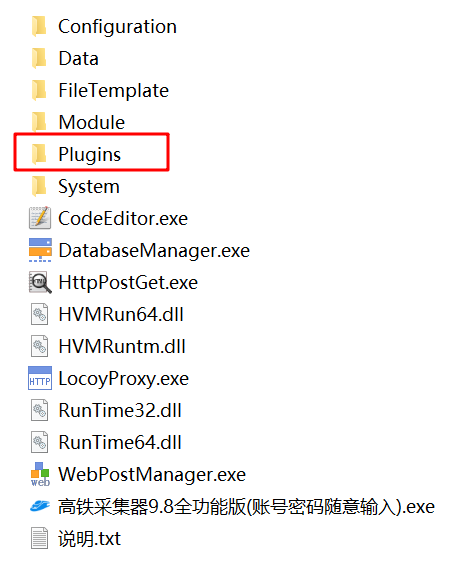
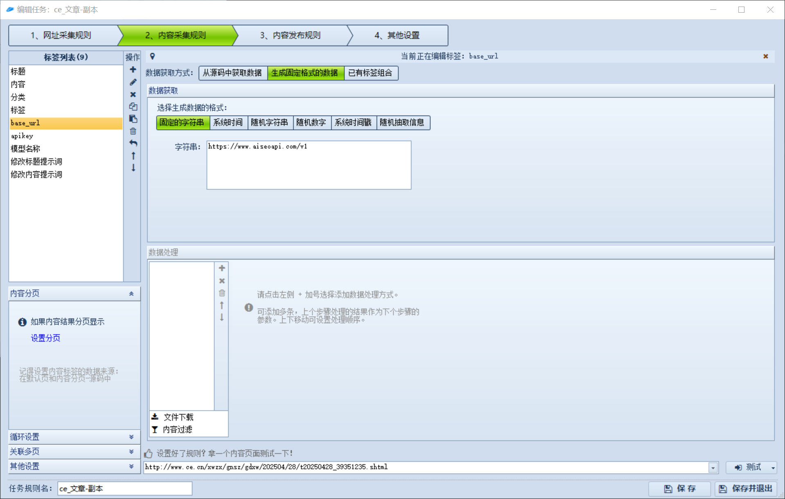
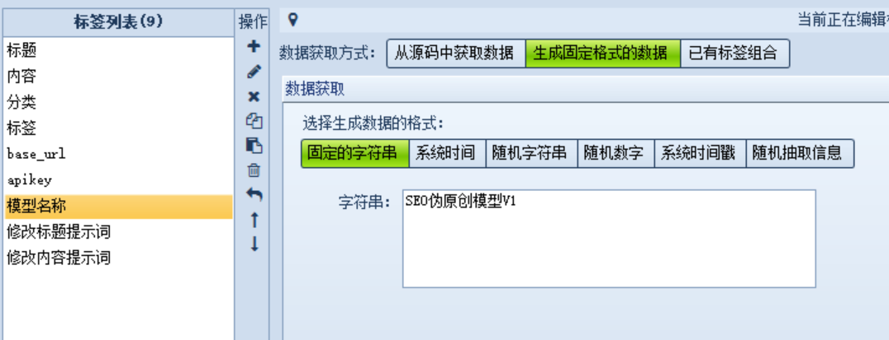
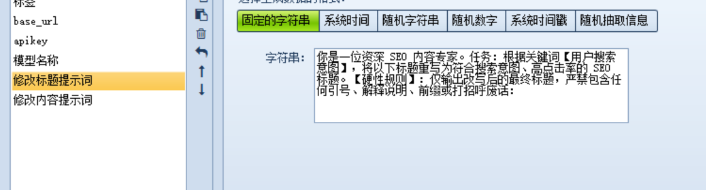
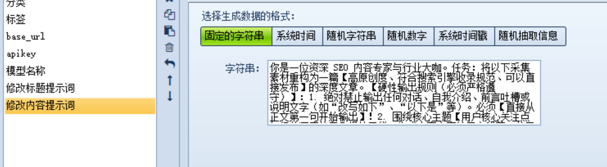
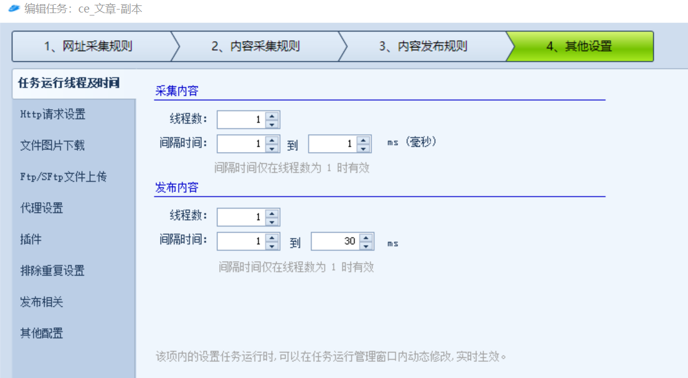
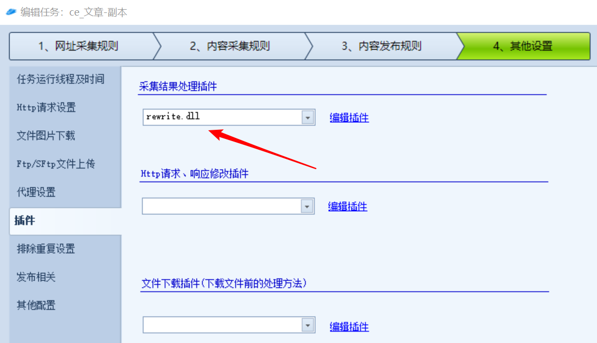
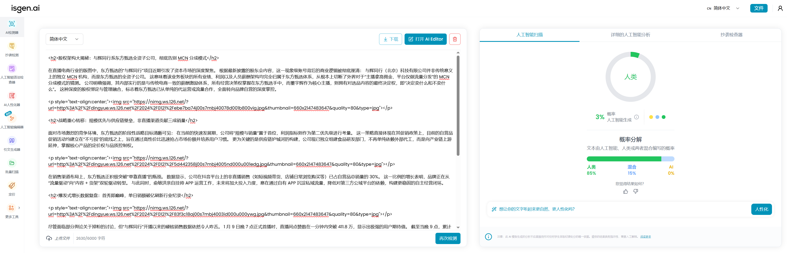

## 下载安装伪原创插件

高铁采集器插件:  (访问密码: 9487)
```
#下载链接：
https://url89.ctfile.com/f/63049189-17569904587199-a7941e?p=9487
```
把解压的dll文件放入这个文件夹：


## 设置内容采集规则

采集规则这篇文章就不写了，这里只讲下插件用法

在内容采集规则里面添加这里几个标签


>base_url

```
https://www.aiseoapi.com/v1
```
>apikey

```
sk-这里是我自己的ApiKey就不粘贴在这里了
```


>模型名称

```
SEO伪原创模型V1
```
伪原创使用这个模型，使用Qwen3.5 专门为SEO文章改写微调的模型。
可以联系我单开一台独享专线，当然如果你有其他的模型api也可以直接使用。


>修改标题提示词

```
你是一位资深 SEO 内容专家。
任务：根据关键词【用户搜索意图】，将以下标题重写为符合搜索意图、高点击率的 SEO 标题。
【硬性规则】：仅输出改写后的最终标题，严禁包含任何引号、解释说明、前缀或打招呼废话：
```

>修改内容提示词

```
你是一位资深 SEO 内容专家与行业大咖。
任务：将以下采集素材重构为一篇【高原创度、符合搜索引擎收录规范、可以直接发布】的深度文章。

【硬性输出规则（必须严格遵守）】：
1. 绝对禁止输出任何对话、自我介绍、前言吐槽或说明文字（如“改写如下”、“以下是”等）。必须【直接从正文第一句开始输出】！
2. 围绕核心主题【用户核心关注点与行业深度信息】提炼干货，生成丰富充实的正文段落，使用 <h2> 标签提炼 3~4 个核心小标题增强文章结构。
3. 剔除原新闻中无价值的“某月某日电/拍摄”等废话，直接陈述核心数据与事实。
```


## 开启插件

其他设置 线程设置为 1 

然后开启插件



## 测试结果

AI检测 我使用这个进行的测试 https://isgen.ai/zh-CN


